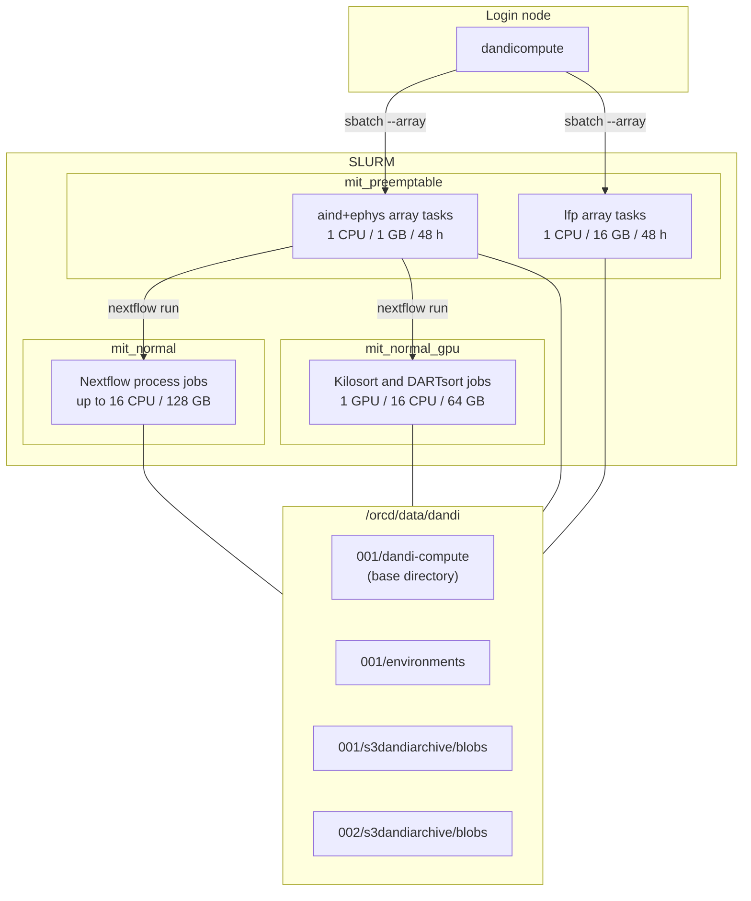

# Infrastructure

DANDI Compute runs on [MIT Engaging](https://orcd-docs.mit.edu), the MIT Office of Research Computing and Data's SLURM cluster. This page describes what it depends on there and elsewhere, and where each piece lives.

## Where things run



The login node only prepares and submits. Everything heavy runs as SLURM jobs, and every job reads its input from the cluster's local mirror of the archive's blobs rather than downloading it.

## The base directory

Every command takes `--base`, defaulting to `/orcd/data/dandi/001/dandi-compute`. Its layout is fixed.

```text
/orcd/data/dandi/001/dandi-compute/
├── dandi-compute-core/          # checkout of this repository, installed with pip -e (not read by path)
├── aind-ephys-pipeline/         # checkout of the AIND ephys pipeline, tags checked out per job
├── work/                        # Nextflow work directories
│   ├── job-{id}/                # one per AIND capsule
│   └── apptainer_cache/         # container images, AIND and LFP, kept by `clean --work`
└── processing/
    ├── prepare-job-XXXXXXXX/    # one preparation tree per capsule (see below)
    │   └── 001697/
    │       ├── dandiset.yaml
    │       └── derivatives/.../job-{id}/
    ├── move-capsule-XXXXXXXX/   # temporary, while `archive add` moves a capsule
    ├── dandicompute-dispatch-{pipeline}-{YYYYMMDD-HHMMSS}/   # one per dispatch
    │   └── task-{array job}-{task}/
    ├── derivatives/logs/dandicompute-dispatch-{pipeline}/   # manifests, scripts, array logs
    └── done.txt                 # preparation trees whose script ran to completion
```

| Path | Written by | Removed by |
|---|---|---|
| `dandi-compute-core/` | Kept up to date by hand with `git pull` | Never |
| `aind-ephys-pipeline/` | Kept up to date by hand. Each AIND job runs `git checkout {version}` in it before starting. | Never |
| `work/` | Nextflow | `dandicompute clean --work` |
| `processing/prepare-job-*` | `prepare aind`, `jobs create` | Nothing automatic |
| `processing/dandicompute-dispatch-*` | `jobs dispatch` | `dandicompute clean --dispatch`, once no dispatcher is live and the directory is old enough |
| `processing/derivatives/logs/` | `jobs dispatch` and its array tasks | Never. It is the permanent dispatch record. |
| temporary trees from `jobs refresh`, `issues`, `archive add` | Those commands | The same command on success. Kept with `--test`, or when a step fails. |

:::{important}
A capsule's `submit.sh` runs against its **preparation tree**, by absolute path. The pipeline writes its intermediate results, logs and outputs there, and its closing `dandi upload` uploads from there. The copy of `code/` an array task downloads is used only to claim the capsule and read the script. A preparation tree must therefore stay in place until its capsule has run.
:::

Because the AIND submission script checks out a tag in the shared `aind-ephys-pipeline/` checkout, two AIND capsules targeting different pipeline versions should not start at the same moment. In practice every new capsule targets the latest tag, so they agree.

## Software on the cluster

| Component | Where | Used for |
|---|---|---|
| Environment modules | `/etc/profile.d/modules.sh` | Loading `miniforge` and `apptainer` in every submission script |
| Conda environment `name-nextflow_version-25+10+4_environment` | `/orcd/data/dandi/001/environments/` | Nextflow 25.10.4 and the DANDI CLI for AIND capsules. The Update codebase workflow of dandi-compute-runner provisions it and installs the `nf-schema` plugin. Capsules formed before it keep the older `name-nextflow_environment` their `submit.sh` names. |
| Conda environment `name-lfp_environment` | `/orcd/data/dandi/001/environments/` | `duct` and the DANDI CLI for LFP capsules |
| Apptainer | module | Running every pipeline container |
| DANDI CLI | the environment running `dandicompute`, and each pipeline environment | Every download, upload and delete against the archive. AIND capsules upgrade it with `pip install -U dandi` before uploading. |
| `sbatch`, `squeue` | SLURM | Submitting arrays, detecting live dispatchers |

The AIND ephys pipeline also needs `NUMBA_CACHE_DIR` to be set in `~/.bashrc` to the shared `work/` directory, which holds each capsule's own Nextflow work directory. Its Nextflow config passes `KACHERY_ZONE`, `KACHERY_API_KEY`, `NUMBA_CACHE_DIR`, `HDF5_USE_FILE_LOCKING` and `HF_HOME` through to the containers when they are set.

### AIND ephys execution

Each AIND capsule's `submit.sh` is a small driver. It activates the Nextflow environment, checks out the capsule's pipeline version, and runs the release's SLURM entry point with the capsule's `.config` and parameter file. That entry point is `main_multi_backend.nf` up to v1.4.1 and `main.nf` from v1.5.0, which merged the two. Nextflow then submits each pipeline step as its own SLURM job using the resources in the registered config.

Each capsule has its own Nextflow work directory, `work/job-{id}/`. From v1.5.0 the pipeline writes the job's full parameters, input path included, to the top of its work directory, so capsules running at the same time cannot share one. A requeued capsule finds its own work directory again and resumes from the steps already finished. Release v1.5.0 also validates the parameters with the `nf-schema` plugin before any step runs, which needs Nextflow 25.10 or later.

| Nextflow process | CPUs | Memory | Partition |
|---|---|---|---|
| `job_dispatch` | 4 | 32 GB | `mit_normal` |
| `preprocessing` | 16 | 256 GB | `mit_normal` |
| `spikesort_kilosort4`, `spikesort_kilosort25`, `spikesort_dartsort` | 16 + 1 GPU | 64 GB | `mit_normal_gpu` |
| `spikesort_spykingcircus2`, `spikesort_lupin` | 16 | 64 GB | `mit_normal` |
| `postprocessing` | 16 | 64 GB | `mit_normal` |
| `nwb_ecephys` | 4 | 256 GB | `mit_normal` |

These figures come from `configs/name-mit+engaging_revision-8.config`, which the `default` config key points to. It binds the blob mirror of partition `002` into the containers, as earlier revisions already do for `001`, and otherwise keeps revision 7. From v1.5.0 a capsule's input folder only links to its blob, so the steps reach the blob through these binds (see [Reading input data](#reading-input-data)). Revision 7 adds the two spike sorters pipeline v1.5.0 introduced, giving `spikesort_lupin` the CPU allocation of Spyking Circus 2 and `spikesort_dartsort` the GPU allocation of Kilosort, and otherwise keeps revision 6. That revision loads the `nf-schema` plugin, sets `PYTHONNOUSERSITE` so the containers ignore packages in the user's home, and otherwise keeps the resources of revision 5. That revision runs `nwb_ecephys` on 4 CPUs instead of 16. The capsule starts one worker per CPU, and each worker holds about three minutes of padded data while it filters the LFP, because the 0.1 Hz highpass pads every 60 second chunk with 50 seconds on each side. Memory therefore grows with the worker count, not the recording length. Fewer workers keep this step well inside its 256 GB, which the previous revision raised from 64 GB. Its 256 GB for `preprocessing` doubles the revision before that and is hopefully temporary. Motion estimation with DREDge can run in an online batching mode that bounds its memory use on long recordings. Pipeline v1.4.0 supports that mode, and the `default` parameters from v1.4.0 turn it on with one hour chunks. Once runs confirm the lower memory use, preprocessing should go back to a smaller memory request. Time limits follow the partition maximums, 12 hours on `mit_normal` and 6 hours on the GPU partition. The Nextflow driver that submits these jobs runs on `mit_preemptable` for up to 48 hours, since the steps it submits have to queue and run inside its own time limit.

Which sorter a capsule runs is chosen by its parameter file, through `spikesorting.sorter`. The registered `default` parameters leave it null, which the pipeline takes as Kilosort 4. The `lupin` and `dartsort` parameters are the same file with that one field set, so every asset is given a capsule per sorter against the one config. Lupin and Spyking Circus 2 run in the pipeline's base image. DARTsort has an image of its own, `aind-ephys-spikesort-dartsort`, which dandi-compute-runner caches alongside the others.

When Nextflow finishes, the script moves the results out of `intermediate/` into the capsule's `derivatives/`, moves Nextflow's reports into `logs/`, deletes `intermediate/` and uploads the capsule. From v1.5.0 the pipeline also writes `provenance.json`, with the commit of every step, the container tag and the effective parameters. It goes into `logs/` too.

### LFP execution

Each LFP capsule's `submit.sh` runs `python -m dandi_compute_code.lfp_pipeline` inside the `dandi-compute-lfp` image with `apptainer exec`, wrapped in `duct` to record resource usage into `logs/`. The container image tag is the version of this package that prepared the capsule. The image is kept in `work/apptainer_cache/` under the name Nextflow gives the AIND images there. The first capsule of a version that finds it missing pulls it, and every later one reuses it. Both blob partitions are bound into the container, since the input blob is outside the capsule. The output goes to `derivatives/nwb/`.

The script uploads the capsule from a trap on exit, so it is uploaded however the script ends. A failure in any step, including activating the environment or pulling the image, still puts the capsule's logs on the archive. The capsule then reads as `failed` rather than `stalled`. A run that SLURM stops with TERM is treated the same way. Any partial output is removed before a failed capsule is uploaded, since a file under `derivatives/` marks a capsule successful.

## The LFP container

| Property | Value |
|---|---|
| Image | `ghcr.io/dandi-compute/dandi-compute-lfp:{version}` |
| Dockerfile | `src/dandi_compute_code/lfp_pipeline/containers/lfp.Dockerfile` |
| Base | `neurodebian:trixie` |
| Contents | This package plus `src/dandi_compute_code/lfp_pipeline/envs`, in a virtual environment at `/opt/venv` |
| Built by | The manually dispatched `Build and upload LFP container image` workflow |

Since the image tag follows the package version, the container has to be rebuilt and pushed for each release that LFP capsules will be prepared against.

## Reading input data

Capsules never download their input. The cluster keeps a mirror of the archive's S3 blobs, and a capsule's script points straight at the blob by content ID:

```text
/orcd/data/dandi/{partition}/s3dandiarchive/blobs/{id[0:3]}/{id[3:6]}/{content_id}
```

The mirror is kept by the backup jobs of [simple-s3-backup](https://github.com/dandi/simple-s3-backup), which the dandi-compute-runner crontab schedules. They split the blobs across two partitions by the first hex digit of the content ID. Content IDs starting with `0` to `9` go to `001`, and those starting with `a` to `f` go to `002`. That split has changed before, so a capsule is pointed at whichever partition holds the blob when it is prepared. A blob that is on neither has not been mirrored yet. The capsule then expects it under the current split, and preparation logs a warning, since the capsule will fail unless the backup copies the blob before it runs. Only blob assets are supported. Zarr assets cannot be processed yet.

Up to v1.4.1, an AIND capsule passes the blob to the job dispatch step as `--nwb-files` and gives the pipeline the blob's directory as its input. Release v1.5.0 checks those arguments against its parameters schema, which has no `nwb_files`, so the run would stop before any step started. From v1.5.0 the capsule's `submit.sh` therefore links the blob into its own input folder, `work/job-{id}/input/{content_id}.nwb`, and gives the pipeline that folder. The job dispatch step reads the one `.nwb` file it finds there. The link is made once, so a requeued run keeps the same input and Nextflow can resume its finished steps. Nextflow mounts only the input folder into the containers, not the blob it links to, so these capsules need a config that binds both blob partitions. That is revision 8 or later.

## External services

| Service | Address | Used for |
|---|---|---|
| DANDI Archive API | `dandiarchive.org` | Uploading, downloading, deleting and moving capsules, through the DANDI CLI and its Python client |
| DANDI S3 bucket | `dandiarchive.s3.amazonaws.com/dandisets/{id}/draft/assets.jsonld` | The full asset listing of a Dandiset, read by every queue command |
| `dandi-cache/qualifying-aind-content-ids` | GitHub raw, `qualifying_aind_content_ids.jsonl.gz` | Which assets qualify for `aind+ephys` |
| `dandi-cache/qualifying-lfp-content-ids` | GitHub raw, `qualifying_lfp_content_ids.jsonl.gz` | Which assets qualify for `lfp`. A looser superset of the AIND list. |
| `dandi-cache/content-id-to-usage-dandiset-path` | GitHub raw, `content_id_to_usage_dandiset_path.jsonl.gz` | Resolving a content ID to the Dandiset and path it is used at |
| GitHub Container Registry | `ghcr.io/dandi-compute` | The LFP container image |

The login node therefore needs outbound HTTPS to GitHub and to the DANDI Archive and its bucket. The compute nodes need the DANDI Archive, and GHCR for LFP capsules.

## Dandisets

| Dandiset | Contents |
|---|---|
| `001697` | Every live job capsule, `jobs.tsv`, `paths.tsv` and the queue reports |
| `001873` | Archived capsules and their own `jobs.tsv` and `paths.tsv` |

Both are written as draft Dandisets with `dandi upload --allow-any-path`, since capsule paths do not follow the layouts DANDI validates. The account behind `DANDI_API_KEY` needs owner rights on both.

## Continuous integration

| Workflow | Runs on | What it does |
|---|---|---|
| `Deploy tests` | Pull requests, merge queue | The test suite on Ubuntu with Python 3.13, plus a job with the LFP scientific stack installed |
| `Daily tests` | Every day at 12:00 UTC | The test suite on Python 3.11 to 3.14 and schema validation, with an email on failure |
| `Validate LinkML schemas` | Pull requests, merge queue, daily | Compiles every schema and validates every packaged data file against it with the full LinkML toolchain |
| `Build documentation` | Pull requests, pushes to `main` | Builds these docs with warnings as errors |
| `Version Check` | Pull requests touching `src/` or `pyproject.toml` | Fails unless the package version was bumped |
| `Build and upload LFP container image` | Manual | Builds and pushes the LFP container to GHCR |

The documentation is hosted on Read the Docs from `.readthedocs.yaml`.

```{toctree}
:hidden:

setup
dispatch
```
